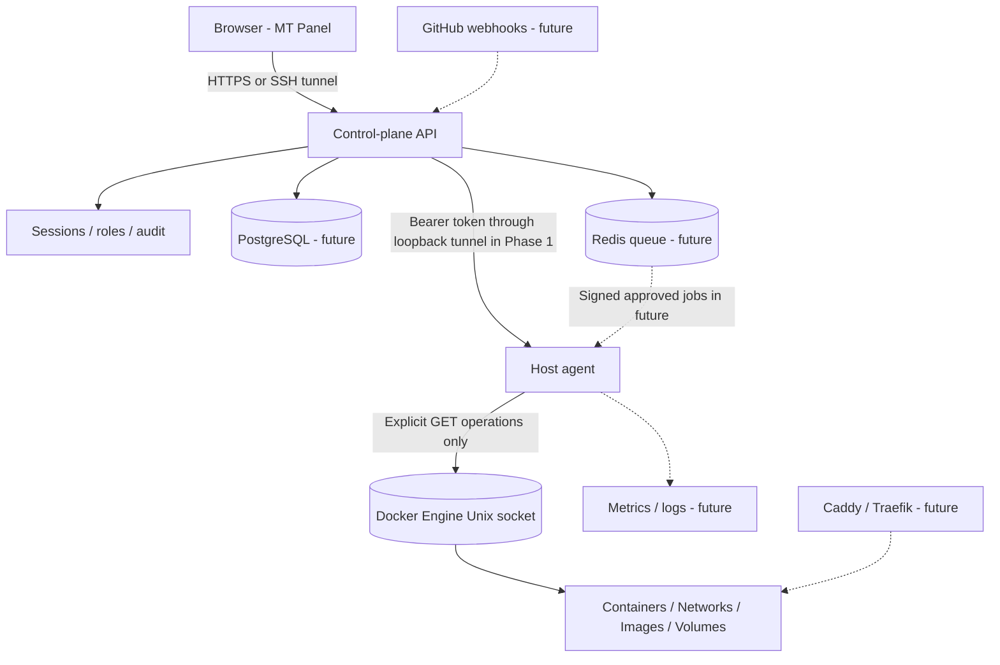

# MT Panel — Technical Product Specification

**Version:** 0.3.12-dev (parallel Next.js static frontend migration)  
**Project status:** Current VPS read-only pilot; the isolated write path is now exercised on ephemeral CI Docker Engine but has not been authorized on the production VPS or a dedicated Tailscale lab VM.  
**Ownership:** Independently written implementation; not an Easypanel fork, copy of its code, or compatible proprietary API.  
**Architecture:** One unprivileged control plane, one constrained Docker inventory agent per host.  
**Deployment safety:** Installed production defaults to read-only; experimental lab-only constrained agent write routes require independent disposable-host opt-in and remain disabled on production.

## 1. Product definition

MT Panel is a secure self-hosted operations dashboard for developers and small organizations managing applications and databases across Linux hosts. The product ultimately covers:

- VPS registration and host health, Docker/Compose inventory, projects, and services.
- GitHub/Git source deployments, Dockerfile and Buildx image builds, Compose validation and deployment.
- Environment management, encrypted secrets, deployment history, health checks, restart, rollback and audit trails.
- Web routing, domains and TLS via **one selectable edge controller**: Traefik on dedicated hosts or Caddy integration on existing hosts.
- Logs, metrics, alerts, image and volume management, scheduled backups and verified restores.
- Operator console, administrative policies and approvals, scoped access across servers.
- One-click curated application templates with validation and pinned image tags/digests.

The first milestone intentionally implements only authenticatable **read-only host inventory**, to preserve existing application uptime.

## 2. User personas

| Role | Intended permissions | Phase |
|---|---|---|
| Owner | Host registration, user management, deployment approval, full audit access | Basic single owner Phase 1, full Phase 4 |
| Administrator | Manage services, images, environments, routes and backup schedules | Phase 3 |
| Operator | Inspect resources, view permitted logs, request deploy/restart | Phase 3 |
| Viewer | View filtered inventory and metrics, no secrets or changes | Phase 3 |

All permissions checked server-side; frontend hiding is not authorization.

## 3. Major boundaries and components

### Control-plane responsibility
- Handles browser authentication, session expiry, request validation, account permissions, inventory presentation.
- Does **not** have Docker socket access and does not execute host commands.
- Stores users and sessions in SQLite for Phase 1; later moves to PostgreSQL with proper migration scripts.
- Connects only to a preconfigured localhost agent endpoint (remote server through approved SSH tunnel, not a dynamic host/URL parameter).

### Host-agent responsibility
- One instance on each managed host; separate service identity.
- Calls a **small allowlist** of Docker Engine `GET` endpoints on `/var/run/docker.sock`.
- Returns filtered inventory rather than raw Docker inspect records containing environment variables or other secrets.
- Validates IDs and limits log fetch length and body sizes.
- Uses token-based authentication, loopback binding, no generic proxy, no arbitrary terminal or shell access.
- Adding a user to the `docker` group grants root-equivalent control; the agent is therefore treated as a high-value privileged component. Merely mounting the socket `:ro` does not enforce API read-only behavior.

### Future queue/worker responsibility
- Serializes deployment jobs per project/host, supports idempotency keys, retry budgets, cancel and lease expiry.
- Records input and output digests, requested/approved user, deployment revision and rollback target.
- Never runs raw user-supplied Docker flags. Agent enforces declarative policy on every sensitive operation.

## 4. Target module design

| Module | Functions | Milestone |
|---|---|---|
| Identity & accounts | Local owner, session cookies, MFA, OIDC, role grants, audit | 1 + 4 |
| Server registry | Host identities, agent pairing, connectivity, heartbeat, capabilities | 2 |
| Projects | Namespaces, resource ownership, environments, labels | 2 |
| Services | App/database/Compose definitions, config revisions, state | 2 |
| Build manager | Git clone with deploy key, Buildx, artifacts, image digest | 2 |
| Deployment worker | Controlled scheduling, locks, health gates, rollback | 2 + 3 |
| Edge gateway | Domain ownership, Caddy or Traefik adapters, TLS | 3 |
| Data resources | DB provisioning, persistent volumes, restore testing | 3 |
| Observability | Container logs, CPU/RAM/network/disk, Loki/Prometheus, alerting | 1 + 3 |
| Backups | Backup catalog, encrypted offsite retention, recovery test | 3 |
| Template catalog | Manifest schema, preview, validation, template versions | 3 |
| Security Center | Audit events, 2FA, RBAC, quotas, approvals, key rotation | 4 |

## 5. UX routes and information hierarchy

- `/`: Login (unauthenticated) or Overview (authenticated), server headline metrics, recent inventory.
- `Overview`: Docker host status, CPU cores, memory capacity, disk used, container count.
- `Containers`: Name, image, runtime state, status, published ports, last 80 log lines.
- `Images`: Local image IDs, repository tags, sizes.
- `Networks`: Name, driver, scope, short ID.
- `Volumes`: Name, driver, scope; mount paths and credential labels suppressed.
- **Upcoming**: Projects, App Service, Deployments, Domains, Databases, Storage, Backups, Monitoring, Audit, Users, Integrations.

Design system: midnight-navy navigation, white/cloud surfaces, restrained teal accents, accessible contrast, responsive tables, keyboard-friendly native buttons and dialogs. No copyrighted Easypanel assets or proprietary icons are reused.

## 6. Phase 1 API contract (implemented)

All inventory routes require an authenticated owner session; agent routes require the shared bearer secret. Errors do not disclose agent secret, Docker environment variables or Docker raw inspection objects.

### Browser/control-plane API

| Method | Route | Purpose |
|---|---|---|
| GET | `/api/health` | Local process check, no secrets |
| GET | `/api/setup` | Whether an offline admin exists |
| POST | `/api/auth/login` | Credentials -> `HttpOnly`, `SameSite=Strict` session cookie |
| POST | `/api/auth/logout` | Invalidate stored session |
| GET | `/api/auth/me` | Current user identity |
| GET | `/api/server/overview` | Filtered host CPU/memory/disk/container counts |
| GET | `/api/server/containers` | Filtered container list |
| GET | `/api/server/images` | Filtered image list |
| GET | `/api/server/networks` | Filtered networks |
| GET | `/api/server/volumes` | Filtered volumes |
| GET | `/api/server/containers/{id}/logs` | Last 80 log lines, bounded response |

### Host agent API

| Method | Route | Backing Docker Engine API |
|---|---|---|
| GET | `/v1/overview` | `GET /info` + local disk usage |
| GET | `/v1/containers` | `GET /containers/json?all=1` |
| GET | `/v1/images` | `GET /images/json` |
| GET | `/v1/networks` | `GET /networks` |
| GET | `/v1/volumes` | `GET /volumes` |
| GET | `/v1/containers/{id}/logs?tail=80` | `GET /containers/{id}/logs?stdout=1&stderr=1&tail=80&timestamps=1` |

No POST/PUT/PATCH/DELETE agent operation is implemented. No arbitrary Docker Engine endpoint is exposed. Agent token is never sent to the browser.

## 7. Target database schema (Phase 2+; not implemented yet)

| Table | Selected columns / relations | Purpose |
|---|---|---|
| `users` | `id`, `username`, `password_hash`, `mfa_enabled`, `created_at` | Account |
| `sessions` | `token_hash`, `user_id`, `expires_at`, `revoked_at` | Session state |
| `servers` | `id`, `name`, `agent_identity`, `status`, `last_seen_at`, `capabilities_json` | Registered host |
| `projects` | `id`, `slug`, `owner_id`, `environment`, `created_at` | Logical grouping |
| `services` | `id`, `project_id`, `server_id`, `kind`, `desired_state`, `config_revision` | Workload definition |
| `service_configs` | `id`, `service_id`, `revision`, `manifest_json`, `created_by` | Immutable configuration |
| `deployments` | `id`, `service_id`, `revision`, `status`, `image_digest`, `requested_by` | Deployment ledger |
| `jobs` | `id`, `type`, `idempotency_key`, `status`, `attempts`, `lease_until` | Async execution |
| `domains` | `id`, `service_id`, `hostname`, `tls_status`, `edge_provider` | Routing |
| `secrets` | `id`, `scope`, `encrypted_value`, `key_version`, `updated_at` | Sensitive settings |
| `backup_plans` | `id`, `service_id`, `schedule`, `destination_id`, `retention` | Backup schedule |
| `backup_runs` | `id`, `plan_id`, `result`, `checksum`, `restore_tested_at` | Recovery evidence |
| `audit_events` | `id`, `actor_id`, `action`, `target_id`, `request_id`, `created_at` | Append-only change tracking |
| `agent_credentials` | `server_id`, `public_key`, `rotation_due`, `revoked_at` | Server trust |

Keys are UUIDs for service/host resources. All mutable resources include version/ETag for optimistic concurrency; server ownership is explicit. Production DB secrets use envelope encryption under a separate key, never plaintext in tables. PostgreSQL row-level security is optional defense-in-depth, not the sole authorization boundary.

## 8. Deployment engine contract (Phase 2)

State machine:

`DRAFT → VALIDATING → QUEUED → BUILDING → STAGED → DEPLOYING → HEALTH_CHECK → SUCCEEDED`

Unsuccessful flows transition to `FAILED`, `CANCELLED`, or `ROLLING_BACK` → `ROLLED_BACK` after verifying rollback health. No silent overwrite of a healthy production deployment.

High-level pipeline:

1. Validate the user, project, host, source provenance and manifest schema.
2. Validate Compose through `docker compose config --format json`, then run our own policy validator on the normalized result. Compose validation alone does **not** make a manifest safe.
3. Refuse privileged containers, host PID/network namespaces, host root mounts, raw daemon sockets and uncontrolled bind mounts unless an explicit high-risk policy and approval allow it.
4. Acquire exclusive deployment lease and archive previous immutable config/image digest.
5. Fetch Git at a pinned commit; build using an isolated worker; avoid passing secrets as Docker build arguments.
6. Deploy via narrow agent action with a signed job, bound service ID, known image digest and approved network policy.
7. Run health probe; on failure, stop progression, preserve logs and use known-good rollback according to service strategy.
8. Save operation/audit timeline, resource references and signed release manifest.

**Note:** Compose `up` can be destructive when configuration changes. All production deployment implementations must be tested with persistent-volume recovery and explicit maintenance/rollback policy before activation.

## 9. Identity and security design

### Phase 1 implementation
- No default admin password; offline password bootstrap required.
- 14+ character admin password with per-user salted scrypt; random session tokens hashed at rest.
- 12-hour sessions stored in SQLite. `HttpOnly`, `SameSite=Strict` cookies; `Secure` required under HTTPS.
- Login throttling (in-memory, per-client, ten attempts/five minutes) and same-origin validation for writes.
- Explicit agent bearer secret of 32+ characters; constant-time comparison.
- Agent uses only a preconfigured loopback URL; no user-controlled URL fetch and no Docker write routes.
- Restrictive browser CSP, clickjacking denial, no-store responses, filtered Docker fields.

### Production prerequisites
- MFA or SSO, centralized rate limiting, session invalidation across nodes, encrypted secret store and key rotation.
- Mutual agent identity (mTLS or signed request identity), token rotation, agent allowlist and replay prevention.
- Least-privilege service unit, server-owner scoping, mandatory action audit logging and approval policies.
- HTTPS origin, proper reverse-proxy allowlist, trust only proxy-provided headers from known IPs.
- Restrict Tailscale connectivity via Grants. No host Docker socket on public TCP, including port 2375.
- Regular vulnerability scanning, dependency locks, signed artifacts, backup and restore drill.

## 10. System requirements and scaling targets

**Phase 1 baseline:** Linux 64-bit VPS, Python 3.11+, Docker Engine for live inventory, 1 vCPU/1 GB RAM recommended for testing (excluding workloads), free localhost ports 8086 and 8788. Running applications still require their own resources. One host supported; no external database required.

**Long-term initial production target:** Up to 20 servers / 200 apps, separated async workers, PostgreSQL and Redis, bounded concurrent builds and queued deploys. These are architecture targets **not measured capacity claims**.

## 11. Operations and availability

- Default bindings are `127.0.0.1:8086` dashboard and `127.0.0.1:8788` agent.
- Existing Caddy on a live VPS must not be modified or its 80/443 ports preempted automatically.
- Tailscale recommended for private access; SSH local port forward is a supported zero-public-port starting option.
- Read-only agent failures return a sanitized 503; they do not restart or modify workloads.
- Demo data is explicitly marked and opt-in only using `AGENT_DEMO_MODE=true`.
- Production needs external monitoring of both services, staged upgrades, release rollback, documented maintenance procedure and tested SQLite-to-PostgreSQL migration.

## 12. Roadmap and acceptance gates

**P1 — Foundation (this repository, v0.1.0)**
- [x] Independent application structure and API.
- [x] Offline owner bootstrap and session login.
- [x] Loopback-only, authenticated, constrained read-only Docker agent.
- [x] Dashboard overview, containers, images, networks and volumes.
- [x] Container log viewing (bounded), demonstration fixture, tests.
- [ ] Live Docker verification on an actual user's test VPS.
- [ ] External security review; not yet production-ready.

**P2 — Git Deploy MVP (target v0.2.0)**
- [ ] Server pairing; PostgreSQL registry, migration and audit store.
- [ ] Project and service model, GitHub auth (GitHub App or deploy key), pinned revision fetch.
- [ ] Buildx pipeline, immutable images, deployment locks and worker queue.
- [ ] Narrow signed agent deployment actions and verified service health gates.

**P3 — Operations (target v0.3.0)**
- [ ] Domains, HTTPS and configurable Caddy/Traefik integration.
- [ ] DB templates, secrets, volumes, backup plans and recovery verification.
- [ ] Restart/redeploy/rollback with RBAC, audit and confirmation.
- [ ] Metrics, logs, alerts, scheduling and templates.

**P4 — Hardened Release (target v1.0.0)**
- [ ] MFA/SSO, multi-user RBAC, agent identity and rotation, rate limiting.
- [ ] Signed release artifacts, SBOM, CI/CD, full integration and security tests.
- [ ] Backup/restore drill, failure injection, production deployment runbook.
- [ ] Scaled multi-server fleet tests and installation/uninstallation wizard.

**No milestone is declared complete solely because a UI entry exists.** Passing integration/security and recovery tests is required.

## 13. Standards and background references

- Docker Engine security: https://docs.docker.com/engine/security/
- Docker socket protection: https://docs.docker.com/engine/security/protect-access/
- Docker Compose normalization: https://docs.docker.com/reference/cli/docker/compose/config/
- Tailscale Grants/access: https://tailscale.com/docs/features/access-control
- Easypanel documentation, as a functional product reference only: https://easypanel.io/docs

## 14. v0.3.8-dev experimental extension (supersedes earlier Phase 1 status notes)

The technical sections describing a GET-only agent reflect the original
Phase 1 production default. The new write API is disabled unless *both*
the panel and the agent are explicitly lab-enabled, with distinct
credentials and a disposable-host acknowledgement. It is not a generic
Engine API proxy; no host changes occur on installation or upgrade.

Local job ledger uses SQLite (not Redis) and records idempotency,
owner-scoped draft snapshots, atomic audits, single-host job leases,
manual queue approval, and fail-closed NEEDS_REVIEW states. A new local
agent action endpoint requires bearer + separately HMAC-signed strict
actions and a durable replay SQLite ledger. Candidate containers are
new, unrouted, non-root and stopped on failed image HEALTHCHECK; previous
workloads remain untouched. Real deployment cutover/rollback requires
a future version and disposable Docker host validation.

[Current Phase A design and security boundary](PHASE_A_LOCAL_EXECUTION.md).

## 15. v0.3.9-dev lab reconciliation (read-only Docker observation)

The local agent now supports a lab-only GET candidate observation,
restricted by original bearer auth, exact job/draft ownership labels and
an immutable job image digest. A same-origin owner route may record
explicitly approved reconciliation of unresolved jobs, but never replays
an uncertain write, releases the per-host fence, or changes Docker.
This is not automatic recovery, multi-server execution or actual service
revision rollback. VPS Git staging synchronization remains operator-run,
never an unattended production deployment system.

## 16. v0.3.10-dev — Real Docker Engine safety test boundary

The allowlisted agent write adapter is exercised against Docker Engine
on GitHub-hosted disposable Ubuntu runners using local immutable-digest
fixture images. Tests confirm health-gated create/start, no network or
host ports, foreign-container refusal, signed nonce replay protection
and independently verified unhealthy-candidate stop. GET-only reads
retain their short timeout, while only STOP receives a bounded longer
timeout. The real integration covers candidate isolation **not**
production service cutover, remote host agent rollout or previous
digest rollback. The installed VPS remains read-only by default.

## 17. v0.3.11-dev — Recovery case evidence

A read-only owner-scoped job packet is hashed over job identity, pinned
manifest hash, state/lease and a bounded state-transition history.
An owner may store a fixed-reason, operator-supplied SHA-256 evidence
reference only in NEEDS_REVIEW state, after exact Origin, session and
explicit review approval. SQLite audit records are atomic, duplicate
requests idempotent, and stale packet fingerprints rejected. Evidence is
**not** independent host attestation; host locking and deployment
execution policy cannot be changed by review submission. The control
plane remains unprivileged and the existing agent/Ed25519 protocol
is unchanged.

## 18. v0.3.12-dev — Frontend security isolation

MT Panel now has a parallel, statically exported Next.js 16 App Router/
TypeScript UI for the eventual web migration. It has no Node server
on production, additional API authority, browser-readable secret, or
new Docker permission. Existing FastAPI/SQLite keeps authentication,
signed agent identity, audit, deployment validation and default-off
execution gates. The prototype is packaged by CI with a commit-bound
static file hash manifest; an operator may explicitly attach it only
to a matching unactivated release. Its use at the private
`/next-preview/` route requires independent opt-in.
Root `/` remains legacy until feature parity and security review.
